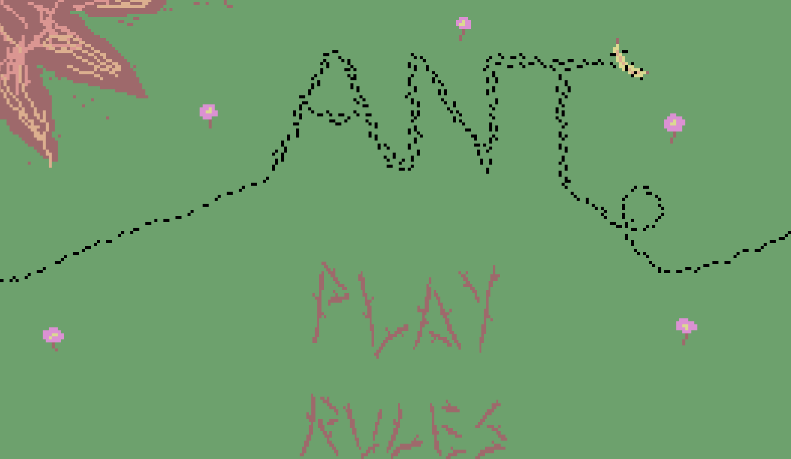
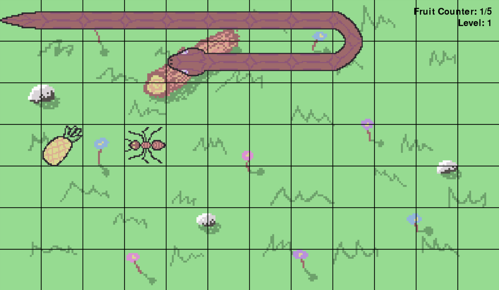

# What is ANT?

This is a game jam project collaborated with me (level 1 student rep), rubenparnell (winner of the 2016 green award) and jpangolin (county sprinter).

You are a **LITTLE** ant getting chased by a **BIG** and **SCARY** snake. **EAT** food, get **POWER** ups, **GROW** bigger, and **EAT** the snake to move on to the next level.
Complete **5** levels to complete the game.

# How to play

There are 2 ways to play:

1. Through the web at [jpangolin.itch.io/ant](https://jpangolin.itch.io/ant).
2. By downloading the source files, creating a virtual environment, installing the required modules via pip (in requirements.txt), and running main.py.

To control the ant, use the arrow keys or WASD.

# Screenshots

# Sound Credits
Walking noise - [Oculus Audio Pack](https://github.com/facebookincubator/Meta-open-sound/releases), FEETHmn_ShoeGrassWalk_OS_05.ogg